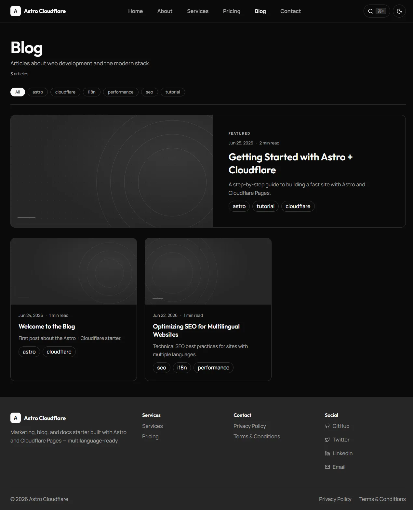
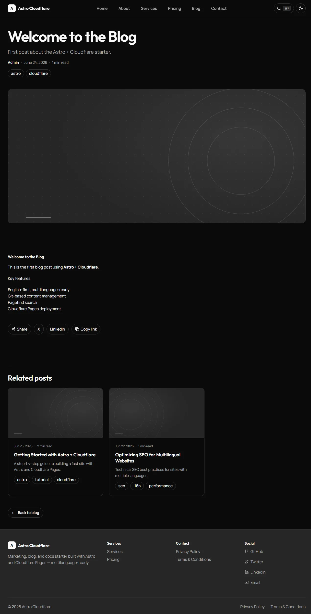

# Astro Cloudflare Starter

A production-ready marketing + blog + docs site built with **Astro 7** and **Cloudflare Pages**. English-first and multilanguage-ready. Content is managed with Git and Markdown — no CMS, no database.

<p>
  
  
</p>

## Features

- English-first with a multilanguage-ready i18n engine (one config file, prefix-based routing)
- Marketing pages, blog, and Starlight-powered docs with full-text search (Pagefind)
- Light/dark theming with a monochrome OKLCH design system and design-token guardrails
- Zero UI-framework runtime — interactivity is small bundled scripts / custom elements
- Strict, hash-based Content Security Policy generated by Astro
- SEO defaults: canonical, hreflang, JSON-LD, Open Graph images, sitemap, RSS, dynamic `llms.txt`
- Optional Cloudflare R2 media storage + a secret-guarded cleanup function
- Static output — fast on the Cloudflare CDN, cheap to host; Lighthouse 100 across the board

## Stack

| Area | Tooling |
|------|---------|
| Framework | Astro 7 (static), Starlight 0.43, MDX 8 |
| Styling | Tailwind CSS 4, OKLCH design tokens |
| Runtime | Node.js 26 LTS, pnpm 12 |
| Types | TypeScript 7 (native `tsc`) + TS 6 compat API for `astro check` / typescript-eslint |
| Quality | Oxlint, ESLint (`.astro`), Stylelint 18, `check:kpis` design guardrails |
| Tests | Vitest 5, Playwright (e2e + CSP), Lighthouse CI |
| Hosting | Cloudflare Pages (+ optional R2, Pages Functions) |
| Updates | Renovate (grouped, SHA-pinned actions) |

## Quick Start

```bash
git clone https://github.com/milzamsz/astro-cloudflare-starter.git
cd astro-cloudflare-starter
corepack enable
pnpm install
pnpm dev
```

Open **http://localhost:4321**.

## Make it yours

After clicking **Use this template**, update these:

- [ ] `src/config/site.config.ts` — `url`, `name`, `description`, `author`, `email`, social links, OG image. Single source of truth (canonical/OG/sitemap/`llms.txt`; `astro.config.ts` reads `url`).
- [ ] `src/config/i18n.config.ts` — locales (English only by default).
- [ ] `src/config/nav.config.ts` — footer GitHub/social URLs.
- [ ] `astro.config.ts` — Starlight `editLink.baseUrl` and the GitHub social link.
- [ ] `wrangler.jsonc` — project `name` and the R2 bucket name (or remove the R2 binding if unused).
- [ ] `public/favicon.svg`, logos, and the default OG image.
- [ ] `.env.example` → `.env`; set `SITE_URL`. Set `CLEANUP_SECRET` as a Cloudflare secret only if you use the R2 cleanup function.
- [ ] Content in `src/content/` (blog, services, pages, docs, settings).
- [ ] `LICENSE` copyright holder and `CHANGELOG.md`.

## Documentation

| Document | Purpose |
|----------|---------|
| [SETUP.md](SETUP.md) | Setup and Cloudflare Pages deployment |
| [CONTRIBUTING.md](CONTRIBUTING.md) | Development workflow and conventions |
| [SECURITY.md](SECURITY.md) | Security model and reporting vulnerabilities |
| [CHANGELOG.md](CHANGELOG.md) | Release notes |
| [AGENTS.md](AGENTS.md) | Rules for AI coding agents |
| `/docs` (Starlight) | In-app guides: getting started, content, i18n, deployment |

## Scripts

```bash
pnpm dev          # start dev server
pnpm build        # production build to dist/
pnpm preview      # preview the production build
pnpm lint         # oxlint + eslint + stylelint + type-check + design/i18n/registry/secret checks
pnpm test         # unit tests (Vitest)
pnpm test:e2e     # end-to-end + CSP tests (Playwright, against dist/)
pnpm lighthouse   # Lighthouse budgets against dist/
pnpm cf:dev       # serve dist/ with Pages Functions via wrangler
```

## Content model

All content lives in `src/content` as Markdown/JSON and is type-checked via content
collection schemas. Each entry uses `<slug>.md` with a `locale` frontmatter field
(English by default). To add a language, see `docs/guides/internationalization`.
Edit files and open a pull request — Cloudflare Pages rebuilds on merge.

## Deployment

Connect the repo to Cloudflare Pages (build command `pnpm build`, output `dist`,
build env var `PNPM_VERSION=12.21.0`), or
deploy manually with `pnpm cf:deploy --project-name=<name>`. See [SETUP.md](SETUP.md).

## License

[MIT](LICENSE)
